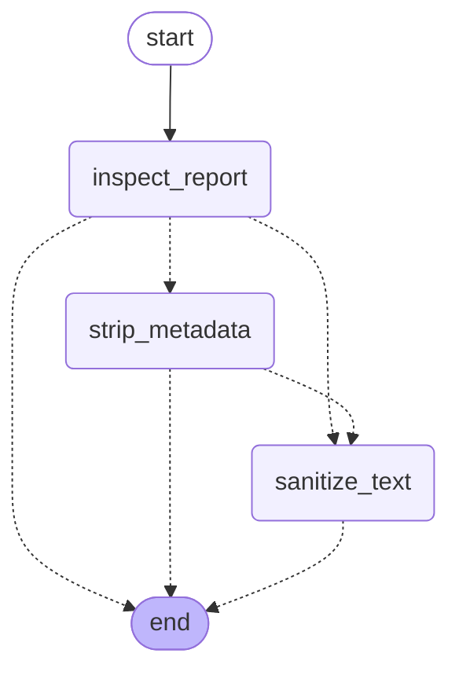
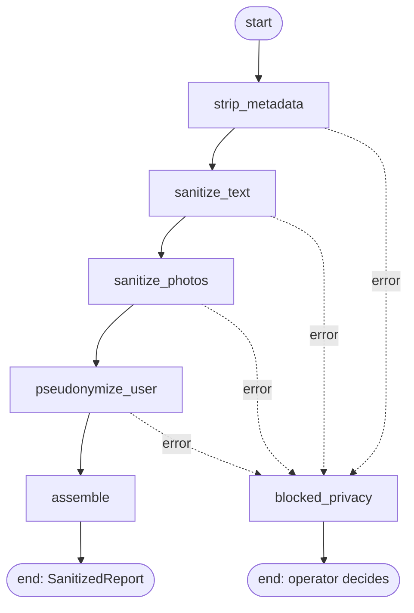

# Privacy layer: graph

## Current state (generated from the code with `make graph` in `backend/`)

Dotted arrows are decisions, not fixed order. After every step a router picks the next step
that applies to this report: `strip_metadata` only if there are photos, `sanitize_text` only
if there is text. A blocked report goes straight to the end (fail closed).

## Planned (hand-drawn, not yet built)

Dotted arrows are the fail-closed branch: any failing step stops the report.
