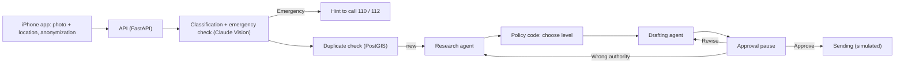

# Ortsbild: Documentation

Status: 2026-10-27. University group project, MVP

This document is the central project documentation. Sections 1 to 3 come from the original handoff (2026-10-26) and are partly outdated by the changes from the team meeting (section 4). The team's current architecture overview is still to come and will then replace section 3.

---

## 1. App concept

**Idea:** Citizens report defects in public space (litter, graffiti, broken playground equipment, potholes) with a photo. A team of agents classifies the report, researches the responsible authority, writes the report and bundles duplicates into one prioritized collective report. The user does as little as possible: a photo, and when in doubt one click.

**Flow:** Photo + location (once) → anonymization on the device → classification and emergency check → duplicate check → research of responsibility → draft → approval by click → sending (simulated in the prototype).

**Three lanes:**
- **Hazard** (e.g. broken climbing frame): one report is enough, never fully automatic, not public.
- **Nuisance** (e.g. graffiti, litter): approval by other users serves as a sorting criterion later.
- **Emergency** (violence, injured people, fire): only a hint to call 110 / 112, no ticket.

**Escalation ladder** (the user's effort grows only with the agent's uncertainty):
- **Level 0:** photo only, the agent reports on its own (low-risk cases, later)
- **Level 1:** photo + 1 click (approve, revise, wrong authority, close)
- **Level 2:** 1 follow-up question by tap
- **Level 3:** help from the user or an operator

**MVP categories:** litter, graffiti, street light, playground equipment, pothole, tree.

**Later:** pinboard with votes, follow-up with authorities, level 0, validator agent.

**Differentiation:** There are many defect reporters. The difference is the agent that researches responsibility itself, bundles duplicates and decides via level logic when the user has to step in.

---

## 2. Planned tech stack (working draft)

This is the current plan and may be adjusted.

| Layer | Plan | Note |
|---|---|---|
| App | Swift, SwiftUI, native iOS | Camera, location, push, Vision for anonymization |
| Backend | Python, FastAPI, Pydantic | Pydantic as the shared data contract |
| Agents | LangGraph + LangChain (model layer, `create_agent`) | Graph with approval pause (interrupt) |
| Models | Claude for agents and image recognition | GPT / Gemini optional for model comparison |
| Database | Supabase (EU): Postgres + PostGIS, storage, anonymous auth | Free plan for the MVP |
| External sources | OSM / Overpass, Nominatim, municipality websites | via `httpx` |
| Tests | `pytest` | 20 to 30 test cases for the evaluation |

**Still open:** authority dashboard (slim web view or mode in the app), backend hosting, example municipality, check the name (App Store, domain).

**Xcode project:** name Ortsbild, SwiftUI, Swift Testing, storage None, no CloudKit, bundle ID `com.joshua-kehrer.ortsbild`.

---

## 3. Architecture



**Two agents (LangGraph):**
- **Research agent:** determines responsibility and channel with tools (municipality registry, OSM, municipality websites, Open311 check). Returns authority, channel, sources and confidence.
- **Drafting agent:** writes the report (factual, neutral). The system generates the factual part, user additions are kept separate.

**Policy code:** a normal function without a model. It chooses the level based on classification, research confidence and channel status. The thresholds are configurable so that autonomy can be measured against error rate.

**Data (Supabase):** reports, clusters, status, municipality registry, drafts and checkpoints in Postgres, photos in storage. The status lives in its own table: `received → classified → researching → draft_ready → approved → sent → closed`.

**Data models (Pydantic, mirrored as Swift `Codable`):**

```python
class Classification(BaseModel):
    category: Literal["litter","graffiti","street_light","playground_equipment","pothole","tree","other"]
    lane: Literal["hazard","nuisance"]
    emergency: bool
    confidence: float          # 0 to 1

class ResearchResult(BaseModel):
    authority: str | None
    channel: dict | None       # type: open311 | email | web_form, target, verified
    sources: list[str]
    confidence: float

class Draft(BaseModel):
    subject: str
    body: str
    user_addendum: str | None
    version: int
```

**API (draft):** `POST /reports` (photo, lat, lon), `GET /reports/{id}`, `GET /reports`, `POST /reports/{id}/actions` (approve, revise, wrong_authority, close).

**Swift structure (start):** `Models/`, `Services/` (`ReportService` protocol + `MockReportService`), `Capture/`, `Privacy/` (Anonymizer, ImageResizer), `Views/`. The app runs against the mock first, the real API follows later.

---

## 4. Changes from the team meeting (2026-10-26)

Status: The team's official architecture overview is still pending. This section records what is known so far.

**Direction: framework instead of just an app.** Ortsbild becomes an intermediary layer between the reporting medium and the authority. The iOS app is an add-on for new users. Existing apps, forms and reporting systems are connected through connectors. All inputs are prepared and processed uniformly before they reach the authority.

- **MVP inputs:** our own app and email. More media later.
- **Connector:** thin adapter that converts the raw data of a source into a uniform input contract (`IncomingReport`). The agents know no source, only this contract.
- **Output:** analogously one adapter per target channel (Open311, email, web form). Not planned yet, but the interface should become visible.
- **`IncomingReport` (draft):** text, attachments (images), optional geodata, source, sender data, reference to the raw data. An email often provides text without a photo and coordinates, the app provides photo and location. Both must be processable.

**Agent team: 6 to 7 agents, each with a very specific task.** The first two are settled:

1. Detect and classify the problem
2. Policy and privacy

The remaining agents are not settled yet. The research and drafting concept from section 3 is a candidate for them.

**Same template per agent:** `state`, `tools`, `prompts`, `graph`, tests. Each agent returns structured output (Pydantic) and plugs in as a node in the overall graph (LangGraph).

---

## 5. Decision: privacy before further processing

The privacy stage runs **before** all other agents, including classification. Raw images and raw texts must never go to an external model provider.

**Why:** With email and third-party systems, data arrives unprotected at the server. Anonymization on the device is then no longer enough. It remains an additional protection layer for the app but is no longer a prerequisite.

**Split of the privacy stage (agent 2):**

1. **Deterministic part in our own backend, no external model call:**
   - Text: patterns and checksums (email, phone, IBAN, license plate), plus a small local NER model for names and addresses (candidates: Presidio, GLiNER).
   - Image: remove EXIF, find faces and license plates with small local detectors (CPU, a few MB), redaction with Pillow/OpenCV.
   - Result: sanitized report plus a log of what was removed.
2. **Model-assisted part, only with sanitized material:** decisions that need context, e.g. whether an address is the defect location or a private address.

**Gateway and raw data:** The connector gateway receives raw data and processes it inside our own backend. For geocoding it sends only the extracted address to the external geocoder, without sender, user identifier or other text, so nothing links the address to a user. A report without a location is not forwarded (the location is mandatory in `IncomingReport`).

**Rejected:**
- A vision language model for finding faces and license plates. That would require sending the raw image to the model provider.
- Self-hosted large models (e.g. Mistral Small 24B via Ollama). They scale poorly and add operational effort. Small detectors in the backend do not have this problem.

**Model layer:** One configuration entry per agent (provider, model, endpoint). A European API is planned for agents after the privacy stage (candidate: Mistral, EU endpoint only, hard-wired in the configuration, never the global default). The provider stays interchangeable until the team has decided.

**Known limits:**
- No detector finds everything (faces turned away, name tags, house numbers, handwriting). Measure the hit rate with real examples and document it.
- Addresses are the weakest class for NER models.
- The result is usually pseudonymization, not full anonymization in the GDPR sense.
- Whether small detectors work well enough on photos of potholes, graffiti and litter is untested.

**Text detector: why GLiNER2-PII (decision 2026-10-28, open to revision after an evaluation)**

Model `fastino/gliner2-privacy-filter-PII-multi` (GLiNER2-PII, May 2026), Python package `gliner2`. The first candidate was `urchade/gliner_multi_pii-v1` (April 2024), which is outdated.

Why this one:
- Small (about 205M parameters), runs on the CPU inside our own backend, no external call. It fits the decision against self-hosted large models.
- German is one of 7 supported languages. It knows 42 entity types, including person, street address, email, phone number, license number and IBAN, so one model covers most of the text step.
- Labels are passed at inference time (zero-shot), new kinds need no retraining.
- License Apache 2.0.
- In the vendor's paper it has the best recall of the compared GLiNER detectors (average 0.718) and the best overall F1 on the SPY benchmark. The old candidate has higher precision but the lowest recall. For us a missed name is worse than a redacted word too many.

Caveats, to be kept in mind:
- The benchmark comes from the vendor itself, is mostly English (legal and medical texts) and all scores are low. It says little about German reports.
- Low precision (0.35 to 0.37): it over-predicts names, sometimes labeling common nouns, organizations or product names as persons. Over-redaction is acceptable for us, but it can blur useful words.
- Trained on synthetic data without human review.
- There is no label for organizations. License plates are covered by `license_number`, not verified for German plates.
- Cost: installing `gliner2` needs `torch` and `transformers` (virtual environment about 1 GB). The first load downloads the model (took about 3.7 minutes here), later calls are fast (about 0.07 s for one report text on the CPU).

Smoke test (one German example, not an evaluation): person, street address, email, phone number and license plate were all found with confidence 0.88 or higher.

TODO: Build a small evaluation set of German reports (email with names, defect address, plates, phone in the signature) and compare against `urchade/gliner_multi_pii-v1` and a plain pattern baseline.

**A detector alone is not the safeguard.** No detector anonymizes reliably, a small model even less. Therefore the privacy layer never relies on one model: patterns with checksums for structured data (email, phone, IBAN) run in addition, low confidence leads to blocking (fail closed), over-redaction is preferred, the redaction log makes every run auditable, and the detector sits behind an interface so it can be replaced. What remains is a residual risk that must be covered legally (pseudonymization, DPAs with the hoster and model providers, EU hosting, data protection sign-off, see section 6).

---

## 6. Legal assessment (state of the discussion, not legal advice)

These points must be signed off by a person with data protection expertise before real citizen data is used, e.g. the university's data protection officer.

- **Controllers** are the operators of the framework (or the authority on its behalf), not the users. The operators conclude the data processing agreement (DPA, German: AVV) with their service providers.
- **Processors:** hoster, Supabase, model provider. A DPA is needed with each.
- **Photographed third parties** do not sign a DPA. A legal basis is needed (typically legitimate interest, Art. 6(1)(f) GDPR, possibly (e) when acting for an authority), plus transparency and data minimization.
- **Users:** Responsibility should lie with the operator, not the user. Relevant for photos are the right to one's own image (KUG §§ 22, 23, 33) and § 201a StGB. The gray area around the user's co-responsibility is open.
- **Mistral (candidate):** according to third-party sources EU endpoint `api.eu.mistral.ai`, DPA for business customers, no training on API data, 30-day retention by default, zero data retention only in certain plans and only for stateless calls. Must be verified against the official documentation.

---

## 7. Hosting

Local is enough for development. As soon as real data flows (at the latest from TestFlight, see section 8):

- Location in the EU (candidates: Hetzner, IONOS, OVH, Scaleway or the EU region of a hyperscaler). With US companies a residual risk remains because of US law.
- DPA with the hoster.
- Supabase: choose the EU region when creating the project (moving later is costly), conclude a DPA.
- Build the backend in a container (Docker), do not hard-wire hoster-specific services, so the hoster stays replaceable.
- Deletion concept: delete raw data after sanitization, no unintended backups containing raw data.

**Open:** choose the hoster, possibly check university infrastructure.

---

## 8. Goal: TestFlight for fellow students

As soon as fellow students upload real photos, real personal data flows. Minimum requirements for the closed test:

1. Backend and Supabase in an EU region.
2. DPAs with hoster, Supabase and model provider.
3. Privacy notice in the app (what happens, that sending is simulated). TestFlight requires a privacy URL and test information for external testers.
4. Explicit consent from testers at first launch, with a note about the test status.
5. No real sending to authorities. Sending stays simulated.
6. Deletion concept: delete test data after the test, fixed deadline, delete button in the app.
7. Rules for testers: no photos of recognizable people, no children, no private property.

**Input in the test:** the app only. Image sanitization runs on the device (Apple Vision), the raw image never leaves the phone. Server-side image sanitization (for email and further connectors) can be pushed back. Text sanitization should be included, because users write names in free text.

---

## 9. Open items

- Wait for the team's architecture overview, then replace section 3.
- Clarify order and scope of agents 3 to 7.
- Categories: do the six MVP categories stay or become configurable per municipality?
- Choose the model provider for agents after the privacy stage.
- Choose hoster and Supabase region, conclude DPAs.
- Have the legal assessment signed off by an expert (section 6).
- Test the image detectors on realistic photos.
- Example municipality, check the name (App Store, domain), authority dashboard.
