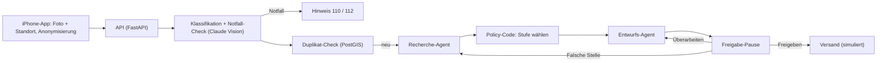

# Ortsbild: Handoff (kompakt)

Stand: 26.10.2026. Uni-Gruppenprojekt, MVP

---

## 1. App-Konzept

**Idee:** Bürger melden Mängel im öffentlichen Raum (Müll, Graffiti, kaputte Spielgeräte, Schlaglöcher) mit einem Foto. Ein Agententeam klassifiziert die Meldung, recherchiert die zuständige Stelle, schreibt die Meldung und bündelt Duplikate zu einer priorisierten Sammelmeldung. Der Nutzer macht möglichst wenig: Foto, im Zweifel ein Klick.

**Ablauf:** Foto + Standort (einmalig) → Anonymisierung auf dem Gerät → Klassifikation und Notfall-Check → Duplikat-Check → Recherche der Zuständigkeit → Entwurf → Freigabe per Klick → Versand (im Prototyp simuliert).

**Zwei Spuren:**
- **Gefahr** (z. B. kaputtes Klettergerüst): eine Meldung genügt, nie vollautomatisch, nicht öffentlich.
- **Ärgernis** (z. B. Graffiti, Müll): Zustimmung anderer Nutzer dient später als Sortierkriterium.
- **Notfall** (Gewalt, Verletzte, Brand): nur Hinweis auf 110 / 112, kein Ticket.

**Eskalationsleiter** (Aufwand des Nutzers wächst nur mit der Unsicherheit des Agenten):
- **Stufe 0:** nur Foto, der Agent meldet selbst (risikoarme Fälle, später)
- **Stufe 1:** Foto + 1 Klick (Freigeben, Überarbeiten, Falsche Stelle, Schließen)
- **Stufe 2:** 1 Rückfrage per Tap
- **Stufe 3:** Hilfe vom Nutzer oder einem Operator

**MVP-Kategorien:** Müll, Graffiti, Laterne, Spielgerät, Schlagloch, Baum.

**Später:** Pinnwand mit Votes, Nachfassen bei Behörden, Stufe 0, Validator-Agent.

**Abgrenzung:** Mängelmelder gibt es viele. Der Unterschied ist der Agent, der die Zuständigkeit selbst recherchiert, Duplikate bündelt und per Stufenlogik entscheidet, wann der Nutzer eingreifen muss.

---

## 2. Geplanter Tech-Stack (Arbeitsdatei)

Das ist der aktuelle Plan und darf angepasst werden.

| Schicht | Plan | Notiz |
|---|---|---|
| App | Swift, SwiftUI, iOS nativ | Kamera, Standort, Push, Vision für Anonymisierung |
| Backend | Python, FastAPI, Pydantic | Pydantic als gemeinsamer Datenvertrag |
| Agenten | LangGraph + LangChain (Modellschicht, `create_agent`) | Graph mit Freigabe-Pause (Interrupt) |
| Modelle | Claude für Agenten und Bilderkennung | GPT / Gemini optional als Modellvergleich |
| Datenbank | Supabase (EU): Postgres + PostGIS, Storage, anonyme Auth | Free-Plan fürs MVP |
| Externe Quellen | OSM / Overpass, Nominatim, Kommunen-Websites | per `httpx` |
| Tests | `pytest` | 20 bis 30 Testfälle für die Evaluation |

**Noch offen:** Behörden-Dashboard (schlanke Web-Ansicht oder Modus in der App), Hosting des Backends, Beispielkommune, Name prüfen (App Store, Domain).

**Xcode-Projekt:** Name Ortsbild, SwiftUI, Swift Testing, Storage None, kein CloudKit, Bundle-ID `com.joshua-kehrer.ortsbild`.

---

## 3. Architektur



**Zwei Agenten (LangGraph):**
- **Recherche-Agent:** ermittelt Zuständigkeit und Kanal mit Tools (Kommunen-Registry, OSM, Kommunen-Websites, Open311-Check). Liefert Stelle, Kanal, Quellen und Konfidenz.
- **Entwurfs-Agent:** schreibt die Meldung (sachlich, neutral). Den Faktenteil erzeugt das System, Nutzerergänzungen stehen getrennt.

**Policy-Code:** normale Funktion ohne Modell. Sie wählt anhand von Klassifikation, Recherche-Konfidenz und Kanalstatus die Stufe. Die Schwellwerte sind konfigurierbar, damit sich Autonomie gegen Fehlerrate messen lässt.

**Daten (Supabase):** Meldungen, Cluster, Status, Kommunen-Registry, Entwürfe und Checkpoints in Postgres, Fotos im Storage. Der Status liegt in einer eigenen Tabelle: `received → classified → researching → draft_ready → approved → sent → closed`.

**Datenmodelle (Pydantic, gespiegelt als Swift-`Codable`):**

```python
class Classification(BaseModel):
    category: Literal["litter","graffiti","street_light","playground_equipment","pothole","tree","other"]
    lane: Literal["hazard","nuisance"]
    emergency: bool
    confidence: float          # 0 bis 1

class ResearchResult(BaseModel):
    authority: str | None
    channel: dict | None       # type: open311 | email | web_form, target, verified
    sources: list[str]
    confidence: float

class Draft(BaseModel):
    subject: str
    body: str
    user_addendum: str | None
    version: int
```

**API (Entwurf):** `POST /reports` (Foto, Lat, Lon), `GET /reports/{id}`, `GET /reports`, `POST /reports/{id}/actions` (approve, revise, wrong_authority, close).

**Swift-Struktur (Start):** `Models/`, `Services/` (`ReportService`-Protokoll + `MockReportService`), `Capture/`, `Privacy/` (Anonymizer, ImageResizer), `Views/`. Die App läuft zuerst gegen den Mock, die echte API kommt später dazu.
